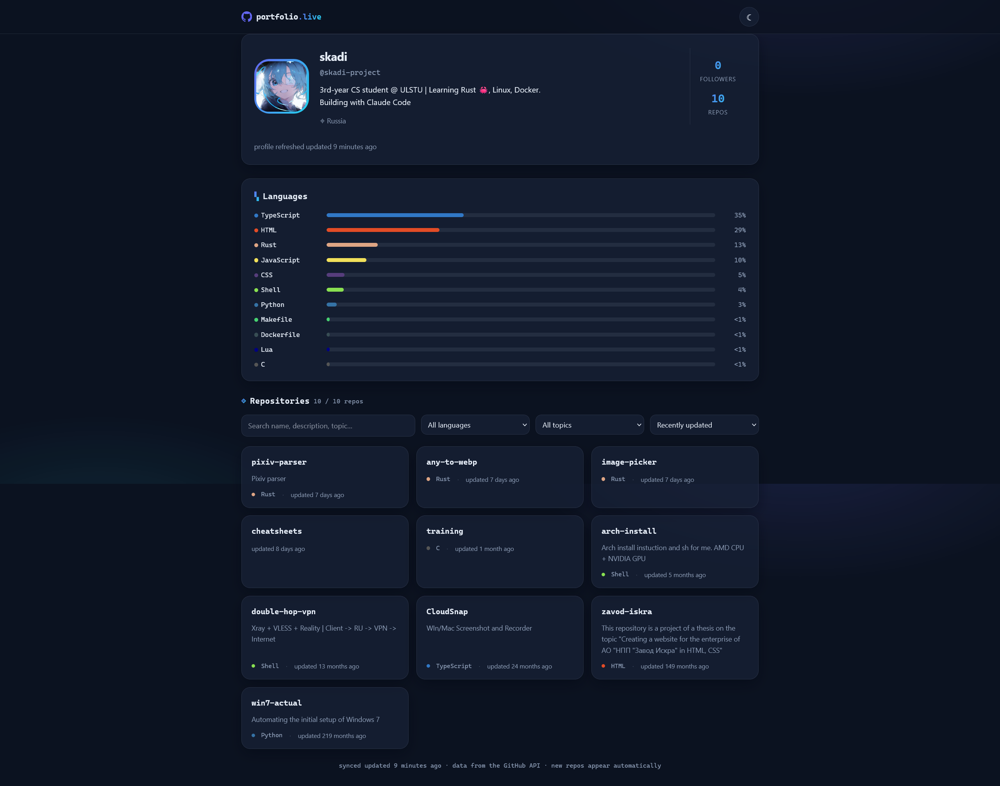
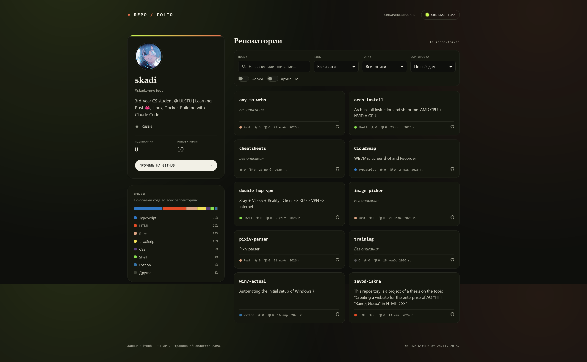
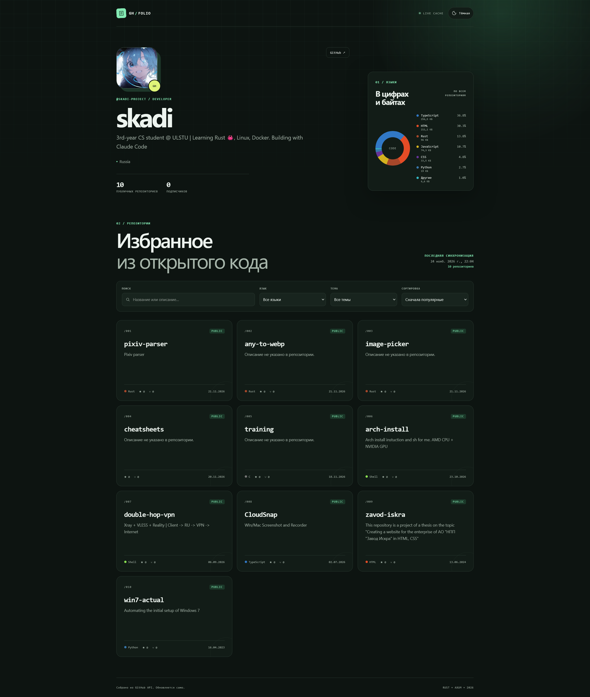
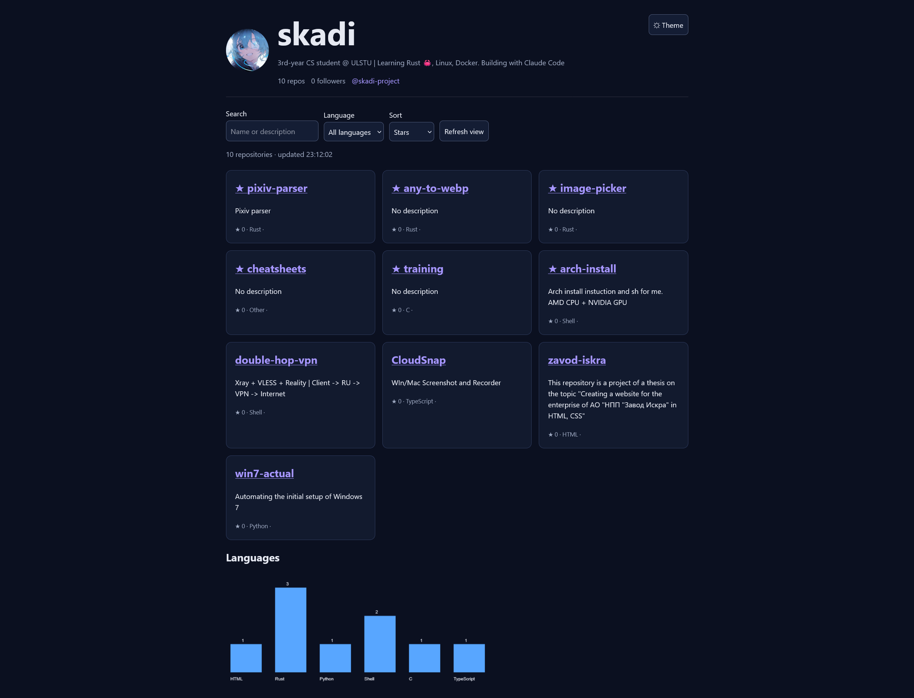
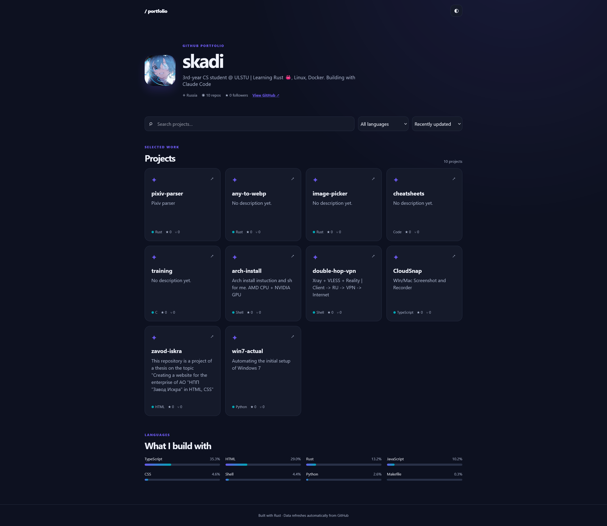
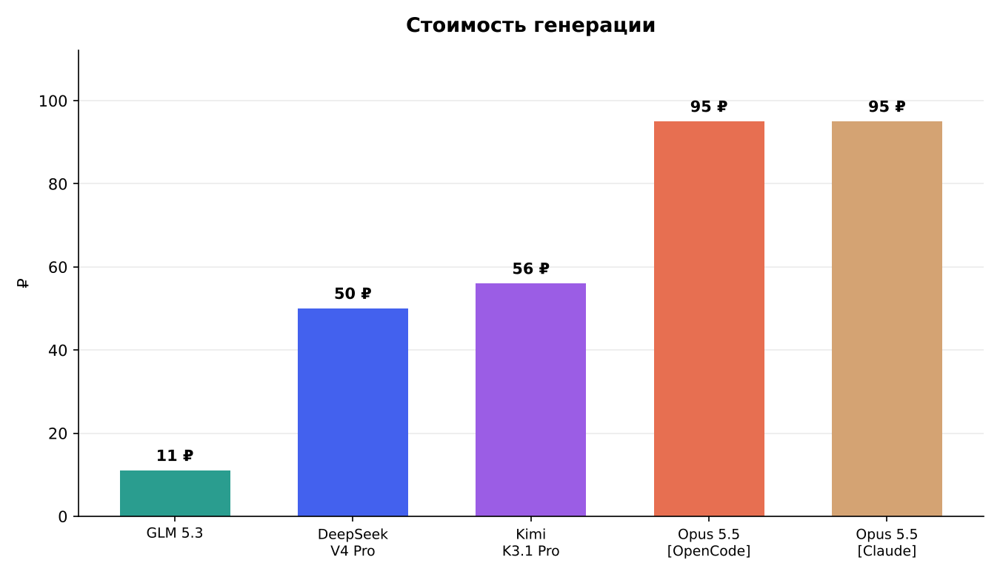
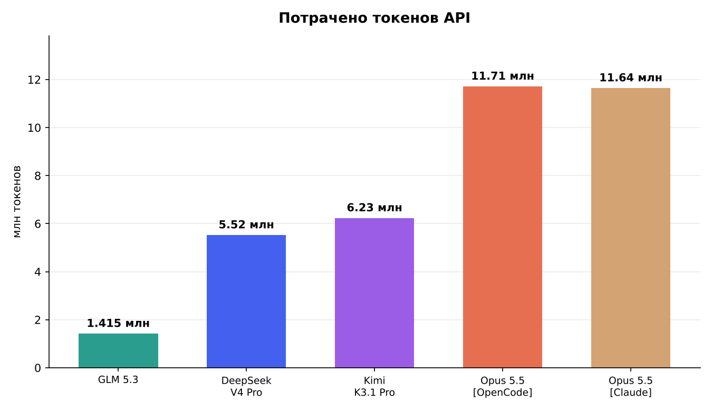
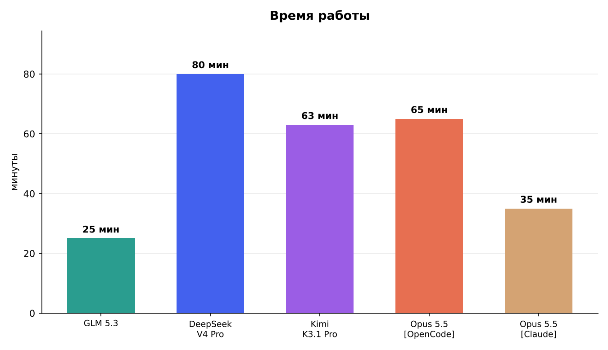
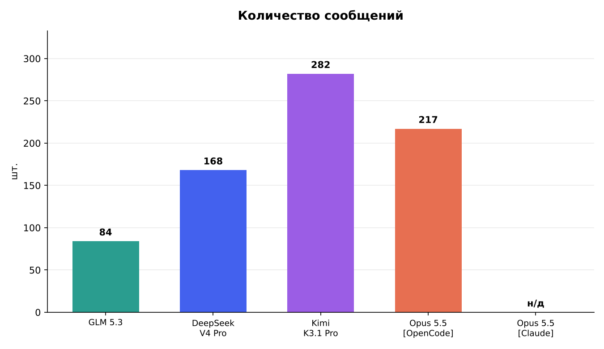
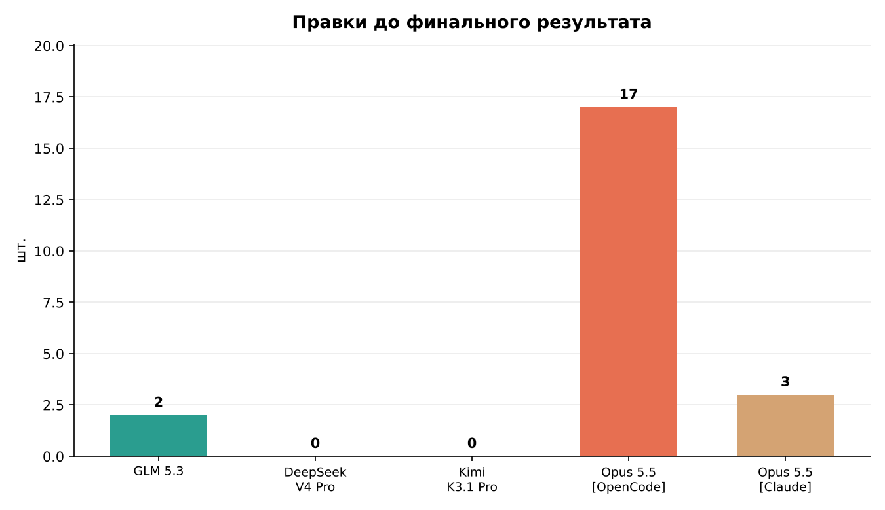

# Тест ИИ-агентов по API в веб-разработке

В пяти прогонах сравниваются связки «модель + агент» на одной задаче: создать сайт-портфолио по GitHub-профилю на Rust с запуском через Docker. Новые репозитории должны появляться на сайте без пересборки и перезагрузки страницы.

## Исходные данные

**Дата проведения:** 24.11.2026

**Провайдер:** Tooken

**Агент:** 

- OpenCode Desktop (2.4.1) - для всех

- Claude Desktop (6.28899.6 (2f5fc5)) - дополнительно для Claude

**ИИ:**

- GLM 5.3

- Deepseek V4 Pro

- Claude Opus 5.5

- Kimi K3.1 Pro

**Правила остановки:** рабочий сайт корректно отображающий информацию

---

## Как проводился тест

Задание для всех прогонов описано в [промпте](PROMT.md). В результатах для всех запусков указан режим `Low`; эквивалентность этого режима между моделями и агентами не проверялась. Диаграммы четырёх прогонов OpenCode лежат в [chats/](chats/).

«API-токены» и «Всего токенов» — разные поля исходной статистики. Способ подсчёта и сверки - статистика в OpenCode Desktop у сессии. Стоимость приведена в рублях по исходным замерам.

Время — длительность прогона, а не чистое время генерации: для DeepSeek и Kimi отмечены задержки API и повторные запросы. Число сообщений не равно числу вмешательств пользователя. 

---

## Предварительные результаты

### GLM 5.3 (Low)

- **Потрачено токенов API:** 1,415 тыс. токенов (пересчет на рубли: 11 рублей)

- **Время работы:** 25 мин

- **Сообщения:** 84

- **Всего токенов:** 73042

- **Входные токены:** 2732

- **Выходные токены:** 1744

- **Токены рассуждения:** 113

- **Токены кэша:** 69824

- **Сообщения ассистента:** 75

- **Комментарий:** 2 правки до финального результата (некорректное чтение .env и компиляция в docker, отключение баннера ошибок по умолчанию)

**Итоговый результат:**

### Deepseek V4 Pro (Low)

- **Потрачено токенов API:** 5,52 млн токенов (пересчет на рубли: 50 рублей)

- **Время работы:** 1 час 20 мин (задержки из-за загруженности API)

- **Сообщения:** 168

- **Всего токенов:** 139645

- **Входные токены:** 142

- **Выходные токены:** 1519

- **Токены рассуждения:** 0

- **Токены кэша:** 137984

- **Сообщения ассистента:** 160

- **Комментарий:** проект был создан без дополнительных запросов

**Итоговый результат:**

### Kimi K3.1 Pro (Low)

- **Потрачено токенов API:** 6,23 млн токенов (пересчет на рубли: 56 рублей)

- **Время работы:** 1 час 3 мин (задержки из-за загруженности API)

- **Сообщения:** 282

- **Всего токенов:** 117685

- **Входные токены:** 635

- **Выходные токены:** 1980

- **Токены рассуждения:** 638

- **Токены кэша:** 114432

- **Сообщения ассистента:** 117

- **Комментарий:** проект был создан без дополнительных запросов

**Итоговый результат:**

### Claude Opus 5.5 (Low) [OpenCode]

- **Потрачено токенов API:** 11,71 млн токенов (пересчет на рубли: 95 рублей) 

- **Время работы:** 1 час 5 мин

- **Сообщения:** 217

- **Всего токенов:** 101346

- **Входные токены:** 7600

- **Выходные токены:** 2312

- **Токены рассуждения:** 52

- **Токены кэша:** 93440

- **Сообщения ассистента:** 153

- **Комментарий:** 17 правок до финального результата (ошибки в получении профиля, отображении репозиториев, доработка четверти функционала, починка docker, сортировки)

**Итоговый результат:**

### Claude Opus 5.5 (Low) [Claude]

- **Потрачено токенов API:** 11,64 млн токенов (пересчет на рубли: 95 рублей)

- **Время работы:** 35 мин

- **Всего токенов:** 56600

- **Комментарий:** 3 правки до финального результата (фикс темной темы, отступ сверзу у заголова и фильтр по языкам)

**Итоговый результат:**

---

## Итог

### Сводная таблица

| Агент / ИИ                                              | API-токены, млн | Стоимость, ₽ | Время       | Сообщения | Правки до финала |
| ------------------------------------------------------- | --------------- | ------------ | ----------- | --------- | ---------------- |
| [OpenCode / GLM 5.3](glm/README.md)                     | 1,415           | 11           | 25 мин      | 84        | 2                |
| [OpenCode / Deepseek V4 Pro](deepseek/README.md)        | 5,52            | 50           | 1 ч 20 мин* | 168**     | 0                |
| [OpenCode / Kimi K3.1 Pro](kimi/README.md)              | 6,23            | 56           | 1 ч 3 мин*  | 282**     | 0                |
| [OpenCode / Claude Opus 5.5](claude-oc/README.md)       | 11,71           | 95           | 1 ч 5 мин   | 217       | 17               |
| [Claude Desktop / Claude Opus 5.5](claude-cd/README.md) | 11,64           | 95           | 35 мин      | -         | 3                |

\* время включает задержки из-за загруженности API.

\*\* число сообщений включает повторные запросы из-за загруженности API.

### Диаграммы

---

## Что работает в каждой реализации

Таблица задаёт единые критерии приёмки по [ТЗ](PROMT.md). «—» означает «не проверено в рамках этой сводки», а не «не работает». 

| Проверка и ожидаемый результат                                                               | GLM      | DeepSeek | Kimi     | Claude / OpenCode | Claude / Desktop |
| -------------------------------------------------------------------------------------------- | -------- | -------- | -------- | ----------------- | ---------------- |
| `docker compose up -d --build`: сайт открывается, `GET /health` возвращает успешный ответ    | работает | работает | работает | работает          | работает         |
| Профиль и список репозиториев отображаются для заданного `GITHUB_USERNAME`                   | работает | работает | работает | работает          | работает         |
| При недоступности GitHub после успешной загрузки сайт продолжает показывать последние данные | —        | —        | —        | —                 | —                |
| Поиск, фильтры по языку и темам, сортировка дают ожидаемый результат                         | работает | работает | работает | работает          | работает         |
| `cargo test` проходит; `cargo clippy -- -D warnings` завершается без предупреждений          | работает | работает | работает | работает          | работает         |

### Краткий вывод

- **GLM 5.3** остаётся лидером по эффективности: 11 ₽ и 25 минут. Это в 4,5–5 раз дешевле DeepSeek и Kimi и почти в 9 раз дешевле Claude. Но в этот раз проект собран не с первого раза: понадобились 2 правки (чтение `.env` и компиляция в Docker, отключение баннера ошибок по умолчанию).
- **Deepseek V4 Pro и Kimi K3.1 Pro** — единственные, кто выдал проект без правок, за 50–56 ₽. Они самые медленные (1 ч 3 мин и 1 ч 20 мин), но время и число сообщений завышены из-за задержек и повторных запросов к API.
- **Claude Opus 5.5** — самый дорогой вариант (95 ₽, около 11,7 млн токенов) в обоих агентах.
- **Важна связка «модель + агент».** При одинаковой стоимости (95 ₽) Claude Desktop справился за 35 минут и 3 правки, а в OpenCode ушло 1 ч 5 мин и 17 правок. Родной агент почти вдвое быстрее и требует почти в 6 раз меньше доработок.
- **Характер правок разный.** В Claude Desktop это в основном визуальные мелочи (тёмная тема, верхний отступ у заголовка, фильтр по языкам). В OpenCode — функциональные проблемы: получение профиля, отображение репозиториев, недоделанная часть функционала, Docker и сортировка.
- **Итоговое качество по приёмке одинаковое:** по таблице проверок все пять реализаций поднимаются в Docker, показывают данные, фильтруют и проходят `cargo test` и `clippy`. Различие только в цене пути до результата.
- **Рекомендации:**
  - быстрые и дешёвые задачи — GLM 5.3, с запасом на пару правок;
  - работа без вмешательства человека — Deepseek V4 Pro или Kimi K3.1 Pro, если не критично время;
  - Claude Opus 5.5 стоит брать в Claude Desktop, а не в OpenCode, и только когда оправдана цена.
